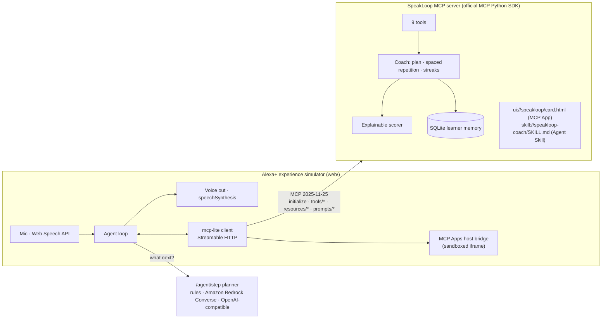

# SpeakLoop — an Alexa+ speaking coach that remembers you

**Alexa+ track · Build, Ship, Shape: Amazon Developer Hackathon 2026**

SpeakLoop turns a voice assistant with a screen into a patient English speaking coach for exam-style
tasks (Read Aloud, Repeat Sentence, Answer Short Question, Describe Image). It listens to you, scores what
it heard, tells you the *one* thing to fix, and remembers which sounds you keep dropping so tomorrow's
session starts where today's left off.

It is built as a **self-hosted MCP server implementing MCP spec 2025-11-25 over Streamable HTTP**, with an
**MCP App** (`text/html;profile=mcp-app`) for on-screen cards and an **Agent Skill** (`SKILL.md`) that
carries the coaching workflow. Because Alexa+ add-on tooling is partner-only, the repo ships an
**Alexa+ experience simulator**: a web page that is a real MCP client (initialize → tools/list →
resources/read → tools/call over Streamable HTTP), with voice in, voice out and a live MCP traffic inspector.

> Built for Vietnamese learners first: millions of students sit English speaking exams, private tutors are
> expensive, and Vietnamese speakers tend to drop the same sounds (final -s/-ed, /θ/, consonant clusters).
> SpeakLoop targets exactly those, with tips in English **and Vietnamese**.


<sub>Above: after the learner says "The lecture was *move* to the main hall", SpeakLoop scores it, highlights
**moved**, and gives one fix in English and Vietnamese. Right: every MCP message of the session.
More: [spaced-repetition review card](docs/img/sound-review.png).</sub>

---

## 60-second quickstart (judges)

```bash
git clone https://github.com/ducvuathuduc/speakloop && cd speakloop
python3 -m venv .venv && source .venv/bin/activate      # Python 3.11+
pip install -r requirements.txt
python scripts/seed_demo.py speakloop.db lan             # optional: 6 days of history for learner "lan"
python -m speakloop.server                              # → http://127.0.0.1:8765
```

Open **http://127.0.0.1:8765** in Chrome or Edge (needed for the microphone; typing works everywhere).
Click the chips in order — *Hi → Practise 10 min → Yes → …* — or press the mic and talk.

No API keys are needed: the default planner is deterministic. To let an LLM drive the conversation (if the model
call fails or is throttled, the session keeps going on the offline planner — see *Fallback* below):

```bash
# Amazon Bedrock with a Bedrock API key (bearer token) — or omit the token to use the standard AWS credential chain via boto3
SPEAKLOOP_LLM=bedrock AWS_BEARER_TOKEN_BEDROCK=... AWS_REGION=us-east-1 BEDROCK_MODEL_ID=amazon.nova-lite-v1:0 python -m speakloop.server
# or: SPEAKLOOP_LLM=openai OPENAI_API_KEY=... python -m speakloop.server
```

Run the tests (33, including a real Streamable HTTP round trip and the official MCP SDK client):

```bash
pip install pytest && python -m pytest -q
```

Point any MCP client at the server: `http://127.0.0.1:8765/mcp` (Streamable HTTP).

---

## What a session looks like

| You say | SpeakLoop does (MCP) | You see / hear |
|---|---|---|
| "Hi" | `get_learner_profile` | "Welcome back, Lan. You're on a 6-day streak. 15 tricky words are due for review. 63 days until your exam." |
| "Let's practise for 10 minutes" | `plan_today_session` | A plan card: sound review first, then the weakest tasks, focus on past-tense **-ed** |
| "Yes" | `start_sound_review` | Spaced-repetition words you missed on earlier days |
| *(says the words)* | `submit_attempt` | Score card, word-level colour diff |
| "Yes" | `start_drill(repeat_sentence, focus=final_ed)` | The coach **speaks** the sentence (not shown — like the real task) |
| *"The lecture was mov to the main hall."* | `submit_attempt` (transcript sent verbatim) | "79 overall. Main fix: past tense -ed. Listen for *moved*." + tip in EN/VI |
| "How am I doing?" | `progress_report` | Trend chart, estimate vs target, streak, recurring weak sounds |

Buttons inside the card (Next drill, My progress, Start step 1) call tools **from the MCP App** through the
host bridge (`tools/call` over postMessage), and the agent's context is kept in sync.

---

## Architecture



* **MCP server** — `speakloop/server.py`, official MCP Python SDK (`mcp==2.3.0`), Streamable HTTP at `/mcp`,
  stateless mode (any replica can answer; state lives in SQLite keyed by learner), DNS-rebinding protection on.
  The handshake negotiates **`protocolVersion: "2025-11-25"`** (asserted in `tests/test_mcp_http.py`).
* **Tools** (all return `structuredContent` with a `speech` line for voice and a `kind` for the card):

  | Tool | Purpose |
  |---|---|
  | `get_learner_profile` | Goal, practice estimate, streak, weak sounds, reviews due (creates learner on first use) |
  | `set_goal` | Target score (10–90 practice scale) and exam date |
  | `plan_today_session` | Agentic plan from history: due reviews → weakest task types, sized to the minutes available |
  | `start_drill` | One drill; picks the weakest task and a focus sound if not given; audio-only tasks are spoken, not shown |
  | `submit_attempt` | Scores a raw transcript + duration; queues dropped sounds for spaced repetition |
  | `start_sound_review` | Spaced-repetition review of words missed on earlier days |
  | `progress_report` | Trend, gap to target, recurring weak sounds |
  | `explain_sound` | Bilingual explanation of a sound pattern |
  | `set_practice_routine` | Saves a daily practice time and returns an iCalendar link (recurring event + 5-minute alarm) |
* **MCP App** — `speakloop/ui_card.html`, served as `ui://speakloop/card.html` with MIME
  `text/html;profile=mcp-app`; every tool declares it in `_meta.ui.resourceUri`. Implements the
  `ui/initialize` → `ui/notifications/initialized` handshake, renders `ui/notifications/tool-result`,
  and calls tools back through the host.
* **Agent Skill** — `skills/speakloop-coach/SKILL.md` (agentskills.io format) plus a reference file, served as
  MCP resources under `skill://speakloop-coach/…`. The simulator reads it at startup and the LLM planners use it
  as their system prompt; the Bedrock path is therefore driven by the skill at runtime.
* **Planner** — `speakloop/agent.py`. `rules` (default, offline), `bedrock` (Amazon Bedrock **Converse API**
  with tool use; MCP tool schemas are mapped to `toolConfig`), `openai` (any compatible endpoint).
  A shared **guardrail** submits the learner's utterance *verbatim* while a drill is active, so no model can
  "correct" the transcript — dropped endings are exactly what the coach measures.
* **Scorer** — `speakloop/scoring.py`. Content (alignment against the reference / key points for Describe Image),
  fluency (words per minute, fillers, restarts) and a pronunciation proxy: a reference word that comes back from
  speech-to-text as a *systematically* different word (books→book, asked→ask, three→tree, most→mos) is flagged
  with the sound pattern behind it. Fully explainable; no audio leaves the device in the simulator.

See [`docs/ARCHITECTURE.md`](docs/ARCHITECTURE.md) for design decisions.

---

## AWS (AWS Builder mini challenge)

* **Amazon Bedrock — Converse API with tool use** is a first-class planner (`SPEAKLOOP_LLM=bedrock`,
  `speakloop/agent.py::bedrock_step`). MCP tool definitions become Bedrock `toolSpec`s; the Agent Skill fetched
  over MCP becomes the `system` prompt; tool results go back as `toolResult` blocks.
* **Two auth paths:** a Bedrock API key in `AWS_BEARER_TOKEN_BEDROCK` (direct HTTPS `POST /model/{id}/converse`
  with `Authorization: Bearer`, no AWS SDK needed), or boto3 with the standard AWS credential chain. Nothing is
  hard-coded; `.env` is git-ignored. See [`docs/AWS.md`](docs/AWS.md) for setup, IAM policy and cost notes.
* **Fallback:** a throttled call (HTTP 429 / `ThrottlingException`, e.g. the daily token quota) trips a circuit
  breaker and the offline planner answers for a cool-down period; any other model error, or a tool name the model
  invented, also falls back to the offline planner for that turn. The learner never sees a dead session.
* Tested with stubbed clients (`tests/test_agent.py`: message mapping, bearer-token HTTP path, schema cleaning for
  Nova, fallback, unknown-tool rejection, throttle circuit breaker). CI never calls AWS.
* Live status (honest): our Bedrock key authenticates against `bedrock-runtime.us-east-1`, but on a new account the
  calls we made returned `429 Too many tokens per day` (see the friction log), so the demo video runs the offline
  planner.

## Honest limitations

* No physical Alexa+ device: Alexa+ add-on tooling is partner-only (hackathon FAQ), so the experience is simulated
  in the browser, which is the path the organisers allow.
* Scores are **practice estimates on a 10–90 scale**, not official exam scores, and the pronunciation signal comes
  from speech-to-text output, not acoustic analysis.
* The drill bank is small (20 original items) — enough to demonstrate the loop.
* `scripts/seed_demo.py` creates earlier practice days with **simulated dates** (scored by the real scorer) so the
  multi-session features are visible in a short demo.

## Repository map

```
speakloop/            server.py (MCP), coach.py (memory/plan/SRS), scoring.py, agent.py (planners), content.py, ui_card.html (MCP App)
skills/speakloop-coach/  SKILL.md + references/   (Agent Skill)
web/                  index.html, app.js (simulator), mcp-client.js (browser MCP client + MCP Apps host bridge)
tests/                pytest suite (unit + Streamable HTTP end-to-end)
scripts/              seed_demo.py, demo_capture.py (headless demo recording)
docs/                 ARCHITECTURE, AWS, PRODUCT_FEEDBACK, FRICTION_LOG, FEATURE_REQUESTS
```

## License

MIT © 2026 Huỳnh Diệu Thành
