<div align="center">

<a href="#-demo">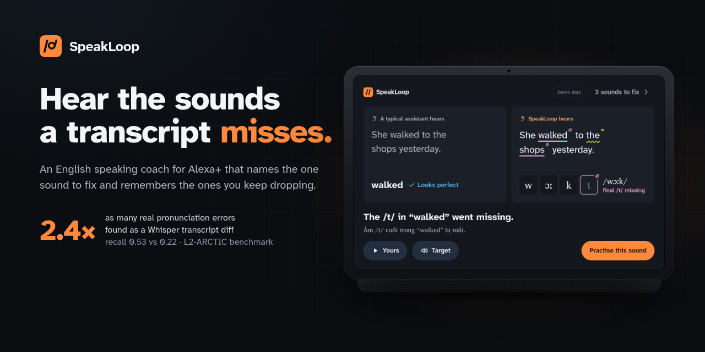</a>

### An Alexa+ English speaking coach that remembers you.

It listens, names the *one* sound to fix, and remembers which sounds you keep dropping,<br>
so tomorrow's session starts where today's left off.

[](https://github.com/ducvuathuduc/speakloop/actions/workflows/ci.yml)
[](#-testing)
[](pyproject.toml)
[](https://modelcontextprotocol.io/specification/2025-11-25)
[](https://github.com/ducvuathuduc/speakloop/releases)
[](LICENSE)

[Quickstart](#-quickstart) ·
[Demo video](#-demo) ·
[Benchmark](#-benchmark) ·
[How it works](#-how-it-works) ·
[MCP tools](#-mcp-surface) ·
[Roadmap](#%EF%B8%8F-roadmap) ·
[Support](#-support)

<a href="assets/speakloop-demo.mp4"></a>

▶ **[Watch the launch film (2:18)](assets/speakloop-demo.mp4)**

<sub>The hero is the v0.2.0 MCP App card rendering <b>demo data</b>. The phone-level scorer behind it is in
<code>main</code> as the <code>assess_pronunciation</code> tool, an optional install (open wav2vec2 weights, ~1.2 GB);
the browser simulator's voice loop still scores the speech-to-text transcript. See
<a href="#-project-status--honest-limitations">Project status</a>.</sub>

</div>

---

> [!NOTE]
> **Built for the Alexa+ track of _Build, Ship, Shape: Amazon Developer Hackathon 2026_.**
> Alexa+ add-on tooling is partner-only, so this repo ships an **Alexa+ experience simulator**: a web page that is
> a real MCP client with voice in, voice out and an MCP traffic inspector. The planner tries Amazon Bedrock, then a
> local model, then a deterministic offline router; with no keys configured (as in the quickstart and the demo) the
> offline router answers. The Bedrock tier is implemented and unit-tested, but live calls from our new AWS account
> currently return `429 Too many tokens per day`; see
> [Project status](#-project-status--honest-limitations).

## 📊 Benchmark

**A transcript can't hear a dropped sound when the recogniser "fixes" the word.** On L2-ARCTIC (Vietnamese speakers),
SpeakLoop's phoneme scorer finds **2.4× as many real pronunciation errors** as diffing a Whisper-small transcript
against the reference, at about the same precision:

| Same 100 held-out utterances · 3,200 phones · 794 mispronounced | Precision | Recall | F1 |
|---|---|---|---|
| Whisper-small transcript diff (baseline) | 0.62 | 0.22 | 0.32 |
| **SpeakLoop phoneme scorer (default thresholds)** | **0.59** | **0.53** | **0.56** |

The cost is more false alarms on correctly said phones: 12.3 % vs 4.5 % for the baseline. Thresholds were tuned on
separate dev speakers only. Method, per-error breakdown and limitations:
**[benchmarks/RESULTS.md](benchmarks/RESULTS.md)** · latency and memory: [benchmarks/LATENCY.md](benchmarks/LATENCY.md).

<div align="center">
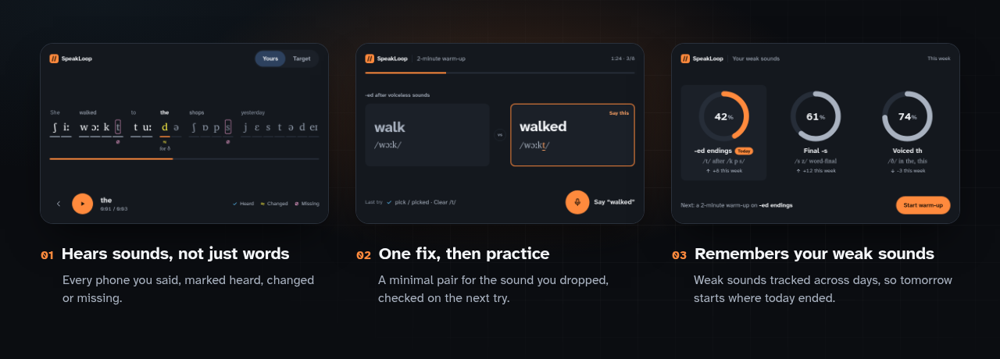
</div>

## 🚀 Quickstart

**Requirements:** Python 3.11+. Chrome or Edge for voice input (typing works in every browser). No API keys.

```bash
git clone https://github.com/ducvuathuduc/speakloop && cd speakloop
python3 -m venv .venv && source .venv/bin/activate
pip install -r requirements.txt

python scripts/seed_demo.py speakloop.db lan   # optional: 6 earlier practice days for learner "lan"
python -m speakloop.server                     # → http://127.0.0.1:8765
```

Open **http://127.0.0.1:8765** and click the chips in order (*Hi → Practise 10 min → Yes / next → …*), or press the
mic and talk. The MCP endpoint is **`http://127.0.0.1:8765/mcp`** (15 tools).

<details>
<summary><b>Optional: phone-level scoring (<code>assess_pronunciation</code>)</b></summary>

The core server runs without it; `assess_pronunciation` returns a clear tool error until the engine is installed.

```bash
sudo apt-get install espeak-ng                    # macOS: brew install espeak-ng
pip install --index-url https://download.pytorch.org/whl/cpu torch
pip install -r requirements-phoneme.txt
python -m speakloop.phoneme.download              # ~1.2 GB of open weights, once (or let the first call fetch them)
```

On CPU the first call pays the model load; peak memory is about 2.3 GB. Numbers in
[benchmarks/LATENCY.md](benchmarks/LATENCY.md).
</details>

> [!TIP]
> `seed_demo.py` writes earlier practice days with **simulated dates** (scored by the real scorer), so streaks,
> due reviews and the progress chart are visible in a short demo. Skip it to start as a brand-new learner.

## 📖 Table of contents

- [Quickstart](#-quickstart)
- [Benchmark](#-benchmark)
- [Why SpeakLoop](#-why-speakloop)
- [Demo](#-demo)
- [Features](#-features)
- [How it works](#-how-it-works)
- [Usage examples](#-usage-examples)
- [MCP surface](#-mcp-surface)
- [Configuration](#%EF%B8%8F-configuration)
- [How scoring works](#-how-scoring-works)
- [Testing](#-testing)
- [Project status & honest limitations](#-project-status--honest-limitations)
- [Roadmap](#%EF%B8%8F-roadmap)
- [Project structure](#-project-structure)
- [Related project: mcp-lite-browser](#-related-project-mcp-lite-browser)
- [Contributing](#-contributing)
- [Support](#-support)
- [License](#-license)
- [Acknowledgements](#-acknowledgements)

## 💡 Why SpeakLoop

Millions of Vietnamese students sit English speaking exams. A private tutor costs more than many families can pay,
and practising alone gives no feedback. Vietnamese speakers also tend to drop **the same sounds**: final **-s** and
**-ed**, **/θ/** in *three* and *think*, consonant clusters. So the same mistakes repeat for months.

A voice assistant with a screen is already in many homes. SpeakLoop turns it into a patient coach that:

- **remembers you between sessions** (streaks, weak sounds, words due for review), instead of answering one turn at a time;
- **explains every score**: each deduction points at a word it heard and the word it expected;
- **says one thing and lets the screen carry the rest**, with tips in English **and Vietnamese**.

## 🎬 Demo

<div align="center">

<a href="assets/speakloop-demo.mp4">
  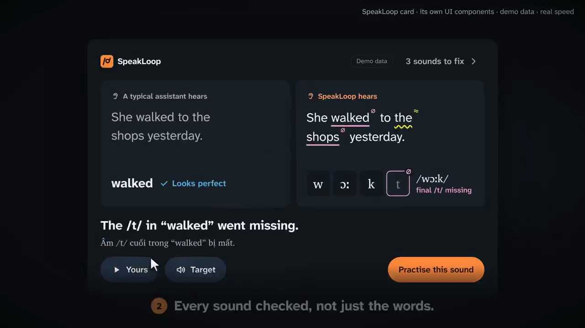
</a>

<sub>▶ <a href="assets/speakloop-demo.mp4">Watch the launch film (MP4, 2:18, 3.7 MB)</a>. GitHub plays it in the browser.</sub>


<sub>A full session at 4× speed: greet → plan 10 minutes → review missed words → Repeat Sentence → scored card → progress.<br>
The right-hand panel is the live MCP traffic between the page and the server.</sub>

</div>

**The core loop, up close.** The coach *speaks* the sentence (it is never shown, like the real exam task). The learner
says *"The lecture was **move** to the main hall."* SpeakLoop scores it, highlights **moved**, and gives one fix:

<div align="center">
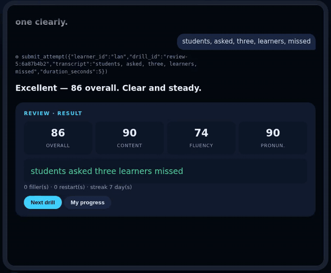
</div>

<table>
  <tr>
    <td width="50%">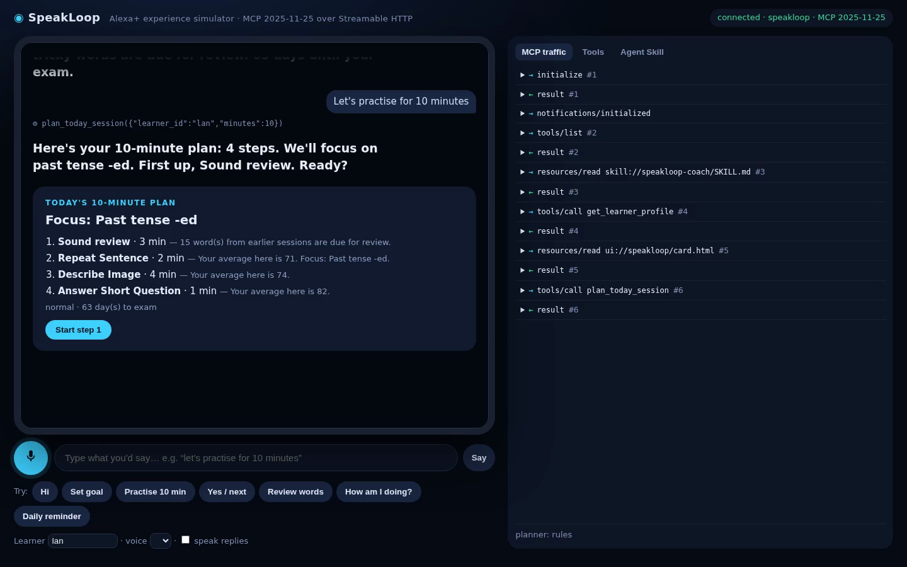<p align="center"><sub><b>Plans today from your history</b>: due reviews first, then your weakest task types</sub></p></td>
    <td width="50%">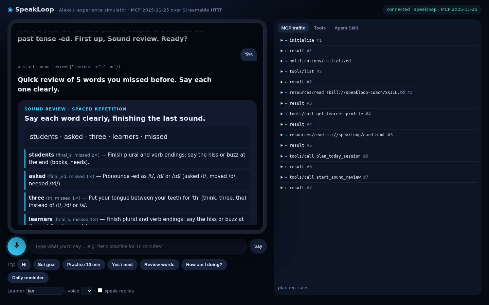<p align="center"><sub><b>Spaced repetition</b> of words you missed on earlier days</sub></p></td>
  </tr>
  <tr>
    <td width="50%">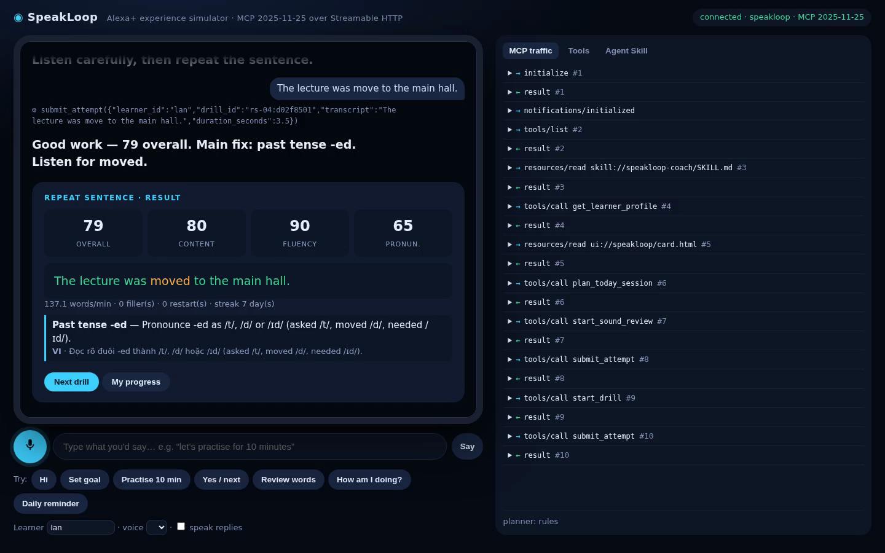<p align="center"><sub><b>Explainable score</b>: word-level diff and one fix, in English and Vietnamese</sub></p></td>
    <td width="50%">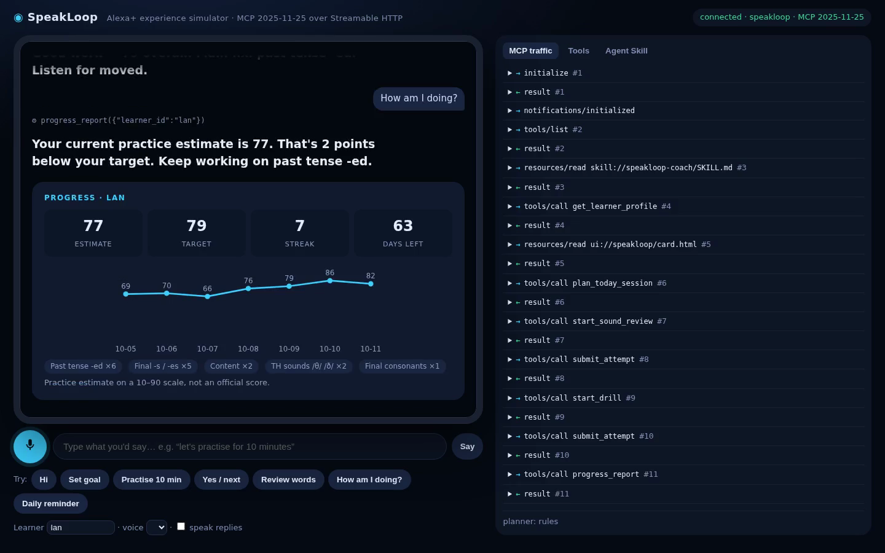<p align="center"><sub><b>Progress</b>: trend, gap to target, streak and recurring weak sounds</sub></p></td>
  </tr>
</table>

## ✨ Features

| | |
|---|---|
| 🗓️ **Plans from history** | "Let's practise for 10 minutes" builds a plan sized to the time you have: due sound reviews, then your weakest task types, with a focus sound. |
| 🎙️ **Exam-style drills by voice** | Read Aloud, Repeat Sentence, Answer Short Question, Describe Image. Audio-only tasks are *spoken*, never displayed (`display_text: null`). |
| 🔬 **Phone-level scoring** *(new in 0.2)* | `assess_pronunciation` hears *sounds*, not words: an open wav2vec2 phoneme recogniser plus goodness-of-pronunciation marks every expected phone heard, changed or missing, then maps errors to Vietnamese-L1 patterns. [Benchmarked](#-benchmark) on L2-ARCTIC. |
| 🧠 **Sound Graph** *(new in 0.2)* | Per-learner memory of *sounds* (not just words) with FSRS spaced repetition and a confusion graph (t→∅, θ→t). `next_drill` / `start_pair_drill` pick what is due. |
| 🌏 **L1 sound packs** *(new in 0.2)* | `skills/l1-vi/` is an installable Agent Skill + data (`pack.json`, `rules.yaml`); `skills/l1-template/` and `python -m speakloop.skillpacks validate` let anyone add a first language. |
| 🔎 **Explainable scoring** | Content, fluency (words per minute, fillers, restarts) and a pronunciation proxy that flags *systematic* substitutions such as books→book, asked→ask, three→tree. |
| 🧠 **Memory across sessions** | SQLite learner memory: streaks, a practice estimate vs. your target (10–90 practice scale), weak sounds, spaced-repetition queue. |
| 🇻🇳 **Bilingual tips** | Every tip in English and Vietnamese, on screen only, so speech stays short. |
| 🃏 **Interactive MCP App** | One `ui://speakloop/card.html` (Preact, built to a single file from `ui/`) follows the Alexa+ design tokens and renders every result: transcript-vs-sounds split, karaoke phone strip, weak-sound rings, minimal-pair drill. Its buttons call tools back through the host. |
| 🧩 **Agent Skill** | `skills/speakloop-coach/SKILL.md` (agentskills.io format) carries the coaching workflow, served over MCP and used as the LLM planner's system prompt. |
| 🛡️ **Transcript guardrail** | While a drill is active, the learner's words go to `submit_attempt` **verbatim**, so no model can "fix" the dropped endings the coach is measuring. |
| ⏰ **Practice routine** | `set_practice_routine` returns an iCalendar feed (recurring event, 5-minute alarm) for any calendar app. |
| 🔌 **Tiered planner** | Strands Agents: Amazon Bedrock → a local llama.cpp model → offline rules, each model tier behind a circuit breaker. Bedrock Converse and OpenAI-compatible planners are also selectable directly. |

## 🧭 How it works

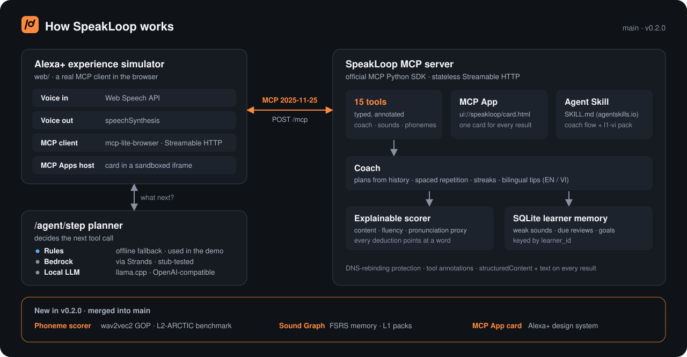

The same flow as Mermaid:

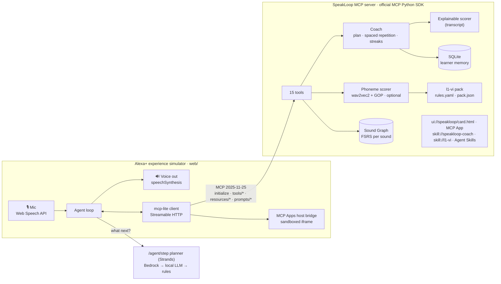

One drill, end to end:

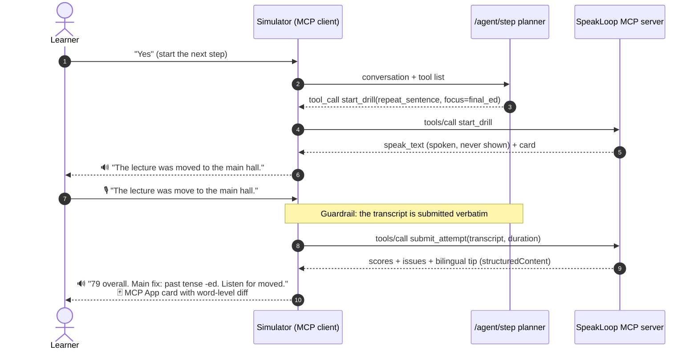

**Design notes** (more in [`docs/ARCHITECTURE.md`](docs/ARCHITECTURE.md)):

- **Stateless Streamable HTTP.** Any replica can answer any request; learner state lives in SQLite keyed by `learner_id`.
  DNS-rebinding protection is on, with an explicit host allow-list.
- **Two outputs per tool.** Every result has `structuredContent` (with a `kind` for the card and a `speech` line for voice)
  *and* a text block, for hosts that ignore structured output.
- **Tool annotations** (`readOnlyHint`, `idempotentHint`) let a host auto-approve safe calls.
- **Protocol version is tested.** The handshake negotiates `protocolVersion: "2025-11-25"`, asserted in `tests/test_mcp_http.py`.

## 🧪 Usage examples

<details open>
<summary><b>Talk to it in the simulator</b></summary>

| You say | SpeakLoop calls | You hear / see |
|---|---|---|
| "Hi" | `get_learner_profile` | "Welcome back, Lan. You're on a 6-day streak. 15 tricky words are due for review. 63 days until your exam." |
| "Let's practise for 10 minutes" | `plan_today_session` | "Here's your 10-minute plan: 4 steps. We'll focus on past tense -ed. First up, Sound review. Ready?" |
| "Yes" | `start_sound_review` | Words you missed on earlier days |
| *(say the words)* | `submit_attempt` | Score card with a word-level colour diff |
| "Yes" | `start_drill(repeat_sentence)` | The coach **speaks** the sentence |
| *"The lecture was move to the main hall."* | `submit_attempt` (verbatim) | "Good work — 79 overall. Main fix: past tense -ed. Listen for moved." |
| "How am I doing?" | `progress_report` | Trend chart, estimate vs. target, streak, recurring weak sounds |

<sub>Lines above are copied from a recorded run with the seeded learner; your numbers depend on your own attempts.</sub>
</details>

<details>
<summary><b>Call it with <code>curl</code> (raw JSON-RPC over Streamable HTTP)</b></summary>

```bash
# 1. Handshake: the server answers with protocolVersion "2025-11-25"
curl -s http://127.0.0.1:8765/mcp \
  -H 'content-type: application/json' -H 'accept: application/json, text/event-stream' \
  -d '{"jsonrpc":"2.0","id":1,"method":"initialize","params":{"protocolVersion":"2025-11-25","capabilities":{},"clientInfo":{"name":"curl","version":"0"}}}'

# 2. Call a tool (stateless server: no session id needed)
curl -s http://127.0.0.1:8765/mcp \
  -H 'content-type: application/json' -H 'accept: application/json, text/event-stream' \
  -H 'mcp-protocol-version: 2025-11-25' \
  -d '{"jsonrpc":"2.0","id":2,"method":"tools/call","params":{"name":"get_learner_profile","arguments":{"learner_id":"lan"}}}'
```

Responses arrive as `text/event-stream` (`event: message` / `data: {…}`).
</details>

<details>
<summary><b>Use the official MCP Python SDK</b></summary>

```python
import asyncio
from mcp import Client  # mcp==2.3.0, as pinned in requirements.txt

async def main():
    async with Client("http://127.0.0.1:8765/mcp") as c:
        tools = await c.list_tools()
        print([t.name for t in tools.tools])
        r = await c.call_tool("start_drill", {"learner_id": "lan", "task_type": "repeat_sentence", "focus": "final_ed"})
        print(r.structured_content["speech"], "→", r.structured_content.get("speak_text"))

asyncio.run(main())
```

This is the same client `tests/test_mcp_http.py::test_official_sdk_client` runs in CI.
</details>

<details>
<summary><b>Connect any other MCP host</b></summary>

Point a Streamable HTTP–capable host (for example the MCP Inspector) at `http://127.0.0.1:8765/mcp`.
If the host reaches the server through another hostname (a tunnel, a container name), add it to
`SPEAKLOOP_ALLOWED_HOSTS`, because DNS-rebinding protection rejects unknown `Host` headers.
</details>

<details>
<summary><b>Let an LLM drive the conversation</b></summary>

```bash
# Amazon Bedrock with a Bedrock API key (bearer token)…
SPEAKLOOP_LLM=bedrock AWS_BEARER_TOKEN_BEDROCK=... AWS_REGION=us-east-1 \
  BEDROCK_MODEL_ID=amazon.nova-lite-v1:0 python -m speakloop.server

# …or the standard AWS credential chain via boto3 (pip install boto3), or any OpenAI-compatible endpoint
SPEAKLOOP_LLM=openai OPENAI_API_KEY=... python -m speakloop.server
```

MCP tool schemas become Bedrock `toolSpec`s, the Agent Skill fetched over MCP becomes the `system` prompt, and tool
results go back as `toolResult` blocks. A throttled call (HTTP 429 / `ThrottlingException`) trips a circuit breaker
and the offline planner answers for a cool-down period; any other model error, or a tool name the model invented,
falls back for that turn. Setup, IAM policy and cost notes: [`docs/AWS.md`](docs/AWS.md).
</details>

## 🔌 MCP surface

**Server:** `speakloop` · **Transport:** Streamable HTTP at `/mcp` (stateless) · **Protocol:** `2025-11-25`

### Tools (15)

Coaching session (9). Every tool except `explain_sound` declares the MCP App in `_meta.ui.resourceUri`.

| Tool | What it does | Key arguments | Hints |
|---|---|---|---|
| `get_learner_profile` | Goal, practice estimate, streak, weak sounds, reviews due. Creates the learner on first use. | `learner_id`, `name?` | read-only · idempotent |
| `set_goal` | Saves target score (10–90 practice scale) and exam date. | `target_score?`, `exam_date?` (YYYY-MM-DD), `name?` | idempotent |
| `plan_today_session` | Plan from history: due reviews → weakest task types, sized to the minutes available. | `minutes` (5–60, default 15) | read-only |
| `start_drill` | Starts one drill; picks the weakest task and a focus sound if omitted. Audio-only tasks return `speak_text`. | `task_type?`, `focus?` | |
| `submit_attempt` | Scores a raw transcript; queues dropped sounds for spaced repetition. | `drill_id`, `transcript`, `duration_seconds?` | |
| `start_sound_review` | Spaced-repetition review of words missed on earlier days. | `limit` (1–10, default 5) | |
| `progress_report` | Trend, gap to target, recurring weak sounds. | `days` (1–90, default 14) | read-only · idempotent |
| `explain_sound` | Bilingual explanation of one feature. | `feature`: `final_s` · `final_ed` · `th` · `clusters` · `final_consonant` · `fluency` · `content` | read-only · idempotent |
| `set_practice_routine` | Saves a daily routine; returns an iCalendar link (recurring event, 5-minute alarm). | `time_local` (HH:MM), `days?`, `minutes` | idempotent |

`task_type` is one of `read_aloud` · `repeat_sentence` · `answer_short_question` · `describe_image`. All learner tools take `learner_id`.

Sound Graph and pronunciation (6, new in v0.2.0). `l1` is an enum of the installed L1 packs (today: `vi`).

| Tool | What it does | Key arguments | Hints |
|---|---|---|---|
| `assess_pronunciation` | Scores a recording phone by phone against the intended sentence; returns every expected phone (heard / changed / missing), word scores and L1 findings, and records misses in the Sound Graph. Needs the optional phoneme engine. | `reference_text`, `audio_wav_base64` (WAV/FLAC, ≤ 30 s), `sample_rate?` (raw PCM only), `learner_id?` | |
| `start_pair_drill` | Minimal-pair card (walk / walked) for a finding, a sound, or whatever FSRS says is due; the differing phone is highlighted. | `focus?` (rule id), `node?` (sound id), `step` | read-only |
| `get_weak_sounds` | Weakest sounds with error rate, FSRS retrievability and top confusions. | `limit` | read-only · idempotent |
| `next_drill` | The sound to drill now (due → weakest → common for the L1) with pairs, words and tips. | `l1` | read-only |
| `record_attempt` | Records a drill result or the scorer's phone errors; updates the FSRS schedule. | `sound_id` + `correct`, or `errors[]` | |
| `progress_summary` | Sound practice over N days: accuracy, most improved, mastered, due. | `days` | read-only · idempotent |

### Resources (5) and prompt (1)

| URI / name | Type | Purpose |
|---|---|---|
| `ui://speakloop/card.html` | `text/html;profile=mcp-app` | The MCP App: one card view for every `kind` (profile, plan, drill, result, review, progress, tip) |
| `skill://speakloop-coach/SKILL.md` | `text/markdown` | The Agent Skill: session flow and voice rules |
| `skill://speakloop-coach/references/vietnamese-l1-pitfalls.md` | `text/markdown` | Reference: the sound patterns the scorer flags |
| `skill://l1-vi/SKILL.md` | `text/markdown` | Vietnamese-L1 sound pack (Agent Skill): how to coach a finding |
| `skill://l1-vi/pack.json` | `application/json` | Machine-readable sounds, detect rules and minimal pairs |
| `daily_session` *(prompt)* | prompt | Kicks off today's coached session for a learner (`learner_id`, `minutes`) |

### HTTP routes

| Route | Purpose |
|---|---|
| `POST /mcp` | MCP Streamable HTTP endpoint |
| `GET /` and `/web/*` | The Alexa+ experience simulator |
| `POST /agent/step` | Stateless "what next?" planner used by the simulator |
| `GET /calendar/{learner_id}.ics` | iCalendar feed for the practice routine |
| `GET /healthz` | Health check: `{"ok": true, "llm_provider": "auto", "planner": {tiers, breakers, …}}` |

## ⚙️ Configuration

All settings are environment variables; copy [`.env.example`](.env.example) as a reference. `.env` is git-ignored.

| Variable | Default | Description |
|---|---|---|
| `HOST` / `PORT` | `127.0.0.1` / `8765` | Bind address |
| `SPEAKLOOP_DB` | `speakloop.db` (repo root) | SQLite file for learner memory |
| `SPEAKLOOP_LLM` | `auto` | Planner: `auto` (Strands tiers below) · `rules` (offline only) · `bedrock` · `openai` |
| `SPEAKLOOP_TIERS` | `bedrock,local,rules` | Tier order for `auto`; model tiers are skipped when not configured |
| `SPEAKLOOP_LOCAL_LLM_URL` | *(empty)* | llama.cpp `llama-server` (or any OpenAI-compatible server) for the `local` tier |
| `SPEAKLOOP_LLM_COOLDOWN_S` | `600` | Seconds to stay on the offline planner after a throttled LLM call |
| `SPEAKLOOP_ALLOWED_HOSTS` | *(empty)* | Extra comma-separated `Host` values allowed (tunnels, containers) |
| `SPEAKLOOP_DISABLE_HOST_CHECK` | *(unset)* | Set to disable DNS-rebinding protection (not recommended) |
| `SPEAKLOOP_PUBLIC_URL` | *(empty)* | Absolute base URL for calendar links; relative when unset |
| `AWS_BEARER_TOKEN_BEDROCK` | *(empty)* | Bedrock API key. Leave empty to use the standard AWS credential chain via boto3 |
| `AWS_REGION` | `us-east-1` | Bedrock region (`AWS_DEFAULT_REGION` also read) |
| `BEDROCK_MODEL_ID` | `amazon.nova-lite-v1:0` | Any Converse-compatible model with tool use |
| `SPEAKLOOP_PHONEME_MODEL` | `facebook/wav2vec2-lv-60-espeak-cv-ft` | Phoneme model (HF id or local path) for `assess_pronunciation` |
| `SPEAKLOOP_PHONEME_DTYPE` / `SPEAKLOOP_PHONEME_THREADS` | `float32` / torch default | Compute dtype (keep float32 on CPU) and intra-op threads |
| `SPEAKLOOP_L1_RULES` | `skills/l1-vi/rules.yaml` | L1 rule file the phoneme scorer applies |
| `SPEAKLOOP_MAX_AUDIO_SECONDS` | `30` | Longest recording `assess_pronunciation` accepts |
| `OPENAI_BASE_URL` / `OPENAI_MODEL` / `OPENAI_API_KEY` | `https://api.openai.com/v1` / `gpt-4o-mini` / *(empty)* | OpenAI-compatible planner |

## 📐 How scoring works

SpeakLoop has two scorers.

**Phone level (`assess_pronunciation`, new in v0.2.0).** `speakloop/phoneme/` runs an open wav2vec2 model that emits
espeak IPA phones, force-aligns the reference sentence (espeak-ng G2P) with CTC, and computes a goodness-of-pronunciation
score per phone. Phones below per-phone thresholds (tuned on L2-ARCTIC dev speakers only, false alarms capped at 15 %)
are flagged as deleted or substituted, and `skills/l1-vi/rules.yaml` turns each flag into a teachable finding
(e.g. `VN-ED-DROP`) linked to a Sound Graph node. It is not a trained assessment model and it can be wrong, so the
coach phrases low-precision patterns as "it sounded like…". Accuracy: [benchmarks/RESULTS.md](benchmarks/RESULTS.md).

**Transcript level (`submit_attempt`, the simulator's voice loop).** `speakloop/scoring.py` is deliberately simple and
fully explainable. No audio leaves the device in the simulator; the browser's speech-to-text produces a transcript
and SpeakLoop scores the transcript.

| Component | Signal |
|---|---|
| **Content** | Alignment against the reference text (keyword coverage for Describe Image; accepted answers, digits included, for Answer Short Question) |
| **Fluency** | Words per minute, filler words, restarts |
| **Pronunciation proxy** | A reference word that comes back as a *systematically* different word, e.g. books→book (final -s), asked→ask (final -ed), three→tree (/θ/), most→mos (final consonant) |

Missed words go into a spaced-repetition queue, and the most frequent pattern becomes tomorrow's focus sound.
Scores are **practice estimates on a 10–90 scale, not official exam scores**.

## ✅ Testing

```bash
sudo apt-get install espeak-ng        # optional: G2P tests skip without it
pip install -r requirements-dev.txt
python -m pytest -q                   # 176 passed, 3 deselected (slow, real-model)
python -m pytest -q -m slow           # 3 passed; needs requirements-phoneme.txt and the model weights
cd ui && npm ci && npm test           # 17 vitest tests for the card's view model
```

Verified locally with Python 3.12 before the v0.2.0 release. CI runs pytest on 3.11, 3.12 and 3.13 with espeak-ng but
without torch, so 5 GOP tests skip there (171 passed, 5 skipped), and vitest on Node 22. The suite covers:

- **Scoring** (`test_scoring.py`): tokenisation, Vietnamese-L1 error patterns, dropped endings, fillers and pace, short-answer near misses, Describe Image keyword coverage.
- **Coach** (`test_coach.py`): goals and profile, a full loop that persists across sessions, spaced repetition and plans, weakest-task selection, routines and iCalendar.
- **Planners** (`test_agent.py`): date/target parsing, rules routing, the verbatim-transcript guardrail, Bedrock message mapping, bearer-token HTTP path, schema cleaning for Nova, fallback, unknown-tool rejection, throttle circuit breaker. **All with stubs, so CI never calls AWS.**
- **Phoneme scorer** (`test_phoneme_fast.py`, `test_phoneme_model.py`): G2P, ARPAbet mapping, L1 rules, TextGrid parsing, GOP on synthetic posteriors; the real model end to end under `-m slow`.
- **Pronunciation tools** (`test_pronunciation_tools.py`): audio decoding and limits, the card shape, phone errors → Sound Graph, `assess_pronunciation` and `start_pair_drill` over Streamable HTTP, and the single canonical `l1-vi` pack.
- **Sound Graph, packs, planner** (`test_memory*.py`, `test_skillpacks.py`, `test_planner.py`): FSRS scheduling, the confusion graph, pack validation and install, the `l1` enum, tier fallback and circuit breakers (Strands stubbed).
- **End to end** (`test_mcp_http.py`): a real uvicorn server over Streamable HTTP: version negotiation, tool metadata, MCP App and Agent Skill resources, a drill round trip, tool errors, the simulator page and path-traversal guard, the calendar route, and the **official MCP SDK client**.

## 🚦 Project status & honest limitations

| Area | Status |
|---|---|
| MCP server, MCP App, Agent Skill, simulator | ✅ Working; covered by tests and shown in the demo |
| Offline rules planner | ✅ Working; answers whenever no model tier is configured, as in the demo video |
| Phoneme scorer + `assess_pronunciation` | ✅ In `main`, optional install; benchmarked offline on L2-ARCTIC ([results](benchmarks/RESULTS.md)). ⚠️ Not yet reachable from the simulator's mic: its card iframe is sandboxed without microphone permission, so the card falls back to "say it to Alexa" there |
| Sound Graph (FSRS), L1 packs, `start_pair_drill` | ✅ Working; covered by tests |
| Strands tiered planner | ⚠️ Local llama.cpp tier smoke-tested on CPU (Qwen2.5-1.5B, [evidence](docs/evidence/local_planner_smoke.json)); Bedrock tier stub-tested only (quota below) |
| Amazon Bedrock planner (Converse + tool use) | ⚠️ Implemented and unit-tested with stubs. Our Bedrock key authenticates, but on a new account every live call returned `429 Too many tokens per day` (details in [`docs/FRICTION_LOG.md`](docs/FRICTION_LOG.md)). The circuit breaker keeps sessions alive on the offline planner. |
| Real Alexa+ device | ❌ Not tested: Alexa+ add-on tooling is partner-only, so the experience is simulated in the browser |

Also worth knowing:

- In the simulator's voice loop the pronunciation signal still comes from **speech-to-text output**; acoustic,
  phone-level scoring is the separate `assess_pronunciation` tool. Its benchmark is one public corpus (L2-ARCTIC,
  two held-out Vietnamese speakers), not a study with learners.
- The drill bank is small: **20 original items** (8 Repeat Sentence, 6 Answer Short Question, 4 Read Aloud, 2 Describe Image).
- Voice input uses the Web Speech API, available in Chromium-based browsers; others fall back to typing.

## 🗺️ Roadmap

- [ ] Run live on Amazon Bedrock once the account's daily token quota allows it, and publish the transcript
- [ ] Deploy behind HTTPS and test with a real Alexa+ MCP host when access opens
- [x] Acoustic, phone-level pronunciation scoring (`assess_pronunciation`, v0.2.0)
- [ ] Microphone permission for MCP App iframes in the simulator (`allow="microphone"`), so the card can call `assess_pronunciation` directly
- [ ] A larger drill bank, plus IELTS and TOEFL task types
- [ ] More first-language packs beyond Vietnamese (the template and validator are ready: `skills/l1-template/`)
- [ ] Swap SQLite for a managed store (e.g. DynamoDB) for multi-replica deployments
- [ ] A pilot with Vietnamese learners

Ideas welcome: [open a feature request](https://github.com/ducvuathuduc/speakloop/issues/new?template=feature_request.yml).

## 🗂️ Project structure

```text
speakloop/
├── speakloop/              # Python package
│   ├── server.py           #   MCP server: 15 tools, 5 resources, 1 prompt, HTTP routes
│   ├── coach.py            #   learner memory, plans, spaced repetition, streaks (SQLite)
│   ├── scoring.py          #   explainable transcript scorer
│   ├── phoneme/            #   phone-level scorer: wav2vec2 CTC, espeak G2P, GOP, L1 rules
│   ├── pronunciation.py    #   assess_pronunciation + start_pair_drill tools
│   ├── memory.py           #   Sound Graph: FSRS per sound + confusion graph
│   ├── memory_tools.py     #   get_weak_sounds · next_drill · record_attempt · progress_summary
│   ├── skillpacks.py       #   L1 pack loader, validator and CLI
│   ├── planner.py          #   Strands tiered planner with circuit breakers
│   ├── agent.py            #   planners: rules · Bedrock Converse · OpenAI-compatible + guardrail
│   ├── content.py          #   20 original drills and bilingual tips
│   └── ui_card.html        #   the MCP App, built from ui/ (ui://speakloop/card.html)
├── skills/
│   ├── speakloop-coach/    # Agent Skill: coaching session flow + references/
│   ├── l1-vi/              # Vietnamese-L1 sound pack: SKILL.md, pack.json, rules.yaml
│   └── l1-template/        # start here to add a first language
├── ui/                     # Preact/Vite source of the MCP App card + vitest
├── benchmarks/             # L2-ARCTIC evaluation, Whisper baseline, RESULTS.md, LATENCY.md
├── web/                    # Alexa+ experience simulator (+ mcp-client.js = mcp-lite-browser)
├── tests/                  # pytest: unit + Streamable HTTP end to end (+ slow real-model tests)
├── scripts/                # seed_demo.py, demo_capture.py, bedrock_smoke.py, local_planner_smoke.py, shoot_cards.py
├── docs/                   # ARCHITECTURE, AWS, FRICTION_LOG, PRODUCT_FEEDBACK, FEATURE_REQUESTS, img/
└── assets/                 # brand kit (brand/), README art (readme/), GIFs, demo video, social preview
```

## 🔗 Related project: mcp-lite-browser

<a href="https://github.com/ducvuathuduc/mcp-lite-browser"></a>

The simulator's MCP client and MCP Apps host bridge are published on their own as
**[mcp-lite-browser](https://github.com/ducvuathuduc/mcp-lite-browser)**: a zero-dependency, single-file ES module
that lets any web page talk to an MCP server over Streamable HTTP and render MCP Apps. `web/mcp-client.js` is a copy
of its `src/index.js`.

<br clear="left">

## 🤝 Contributing

Contributions are welcome: bug reports, drills, translations, docs and code. Read [CONTRIBUTING.md](CONTRIBUTING.md)
to get set up, and please follow the [Code of Conduct](CODE_OF_CONDUCT.md). Security issues: see [SECURITY.md](SECURITY.md).
Release history: [CHANGELOG.md](CHANGELOG.md).

## 💛 Support

SpeakLoop is free and MIT-licensed, built by one student developer. **Sponsorship is not set up yet** (there is no
GitHub Sponsors profile or other payment link), so for now the best support is:

- ⭐ star the repo and share it with a teacher or learner who could use it;
- [open an issue](https://github.com/ducvuathuduc/speakloop/issues/new/choose) with a bug, an idea, or a sound your
  first language makes hard;
- contribute an L1 pack, drills or translations (see [CONTRIBUTING.md](CONTRIBUTING.md)).

## 📄 License

[MIT](LICENSE) © 2026 Huỳnh Diệu Thành

## 🙏 Acknowledgements

- [Model Context Protocol](https://modelcontextprotocol.io) and its [official Python SDK](https://github.com/modelcontextprotocol/python-sdk)
- The MCP Apps extension (SEP-1865) and the [Agent Skills](https://agentskills.io) format
- [Amazon Bedrock](https://aws.amazon.com/bedrock/) Converse API and Amazon Nova models; [Strands Agents](https://strandsagents.com)
- [wav2vec2 phoneme models](https://huggingface.co/facebook/wav2vec2-lv-60-espeak-cv-ft) (Meta AI), [eSpeak NG](https://github.com/espeak-ng/espeak-ng), [L2-ARCTIC](https://psi.engr.tamu.edu/l2-arctic-corpus/) (Texas A&M), [FSRS](https://github.com/open-spaced-repetition/py-fsrs), [Preact](https://preactjs.com) and [Vite](https://vite.dev)
- [Starlette](https://github.com/Kludex/starlette), [Uvicorn](https://github.com/Kludex/uvicorn), [Pydantic](https://docs.pydantic.dev), [HTTPX](https://www.python-httpx.org)
- [Contributor Covenant](https://www.contributor-covenant.org) for the Code of Conduct
- Built for *Build, Ship, Shape: Amazon Developer Hackathon 2026* (Alexa+ track)

<div align="center"><sub>Made in Ho Chi Minh City for every learner practising alone at night. 🇻🇳</sub></div>
