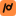

# SpeakLoop brand kit

## The mark

 &nbsp;  &nbsp; 

A phoneme between slashes, written as one loop. The first stroke is the opening slash of phonemic
notation; the second is a single loop that closes into a slanted stem, so the pair reads as **/d/**.
That is the past-tense *-ed* sound (as in *moved*), one of the endings Vietnamese speakers often drop
and the one the demo drill catches. Loop (the session that remembers you) plus phoneme (what it listens for).

- Built from two round-capped strokes on a 64 × 64 grid, so it holds up at 16 px.
- `favicon.svg` uses a heavier stroke (6.6 instead of 5.8) for tab-size rendering.
- Keep clear space of at least 25 % of the tile width on every side. Do not rotate, outline,
  recolour the tile, add gradients or shadows, or set the glyph in a font.

## Files

| File | Use |
|---|---|
| `logo-mark.svg` | App tile: ink glyph on the accent. Works on light and dark. |
| `logo-mark-512.png`, `apple-touch-icon.png` (180) | Raster tile for stores, avatars, iOS home screen |
| `favicon.svg`, `favicon.ico` (16/32/48), `favicon-16/32/48.png` | Browser tabs |
| `logo-glyph-accent.svg` | Glyph alone in accent, for dark backgrounds |
| `logo-glyph-ink.svg` / `logo-glyph-white.svg` | One-colour glyph for light / dark backgrounds |
| `wordmark-light.svg` / `wordmark-dark.svg` | "SpeakLoop" for light / dark backgrounds (text as outlines) |
| `lockup-light.svg` / `lockup-dark.svg` | Tile + wordmark, for light / dark backgrounds |
| `fonts/` | Atkinson Hyperlegible Next (latin subset) and its OFL licence |

The README images (`assets/readme/`), the social preview (`assets/social-preview.png`) and the
Devpost gallery were rendered from HTML with Chromium using these files and the tokens below.

## Colour

From the card design tokens (`ui/src/tokens.css` on the `feat/ui` branch). One accent, used sparingly.

| Token | Hex | Role | Contrast |
|---|---|---|---|
| Accent | `#FF8A3D` | Primary action, the mark tile, one highlight per layout | 7.6:1 on `#14181E` |
| On accent | `#1A1007` | Glyph and text on the accent | 8.0:1 on accent |
| Accent ink | `#FFA466` | Accent used as text on dark | 9.1:1 on `#14181E` |
| Canvas | `#0B0D11` | Page / image background | |
| Card | `#14181E` | Alexa+ dark surface | |
| Inner | `#1B2028` | Nested surface | |
| Line | `#2A313C` | Hairlines, borders | |
| Text | `#F3F5F8` | Primary text on dark | 16.3:1 on card |
| Text 2 | `#A9B2C0` | Secondary text | 8.3:1 on card |
| Text 3 | `#8892A1` | Captions, footnotes | 5.7:1 on card |

**Status colours** (Okabe–Ito, colour-blind safe, always paired with a symbol):
✓ heard `#56B4E9` · ≈ changed `#F0E442` · ∅ missing / + extra `#E59BC8`.

Light backgrounds: text `#14181E`, surfaces `#FFFFFF` / `#FAF9FB`, same accent.

## Type

- **Atkinson Hyperlegible Next** (Braille Institute, OFL) for everything: wordmark 700,
  headlines 800 with −2 to −3 % tracking, body 400–600. Chosen for letter distinction
  (I/l/1, O/0) for learners reading at a distance from an Echo Show.
- **SpeakLoop Phonetic** (a renamed Charis SIL subset, OFL) for IPA in the product UI only.
- Fallbacks: `"Noto Sans", system-ui, sans-serif`.

## Voice in images

Say what the product does in plain words and back each number with its source. No user counts,
company logos, testimonials or rankings. Benchmarks name the dataset, the comparison and the
sample (for example "recall 0.53 vs 0.22 · L2-ARCTIC, same 100 held-out utterances") and show
the cost alongside the win (false alarms 12.3 % vs 4.5 %).
