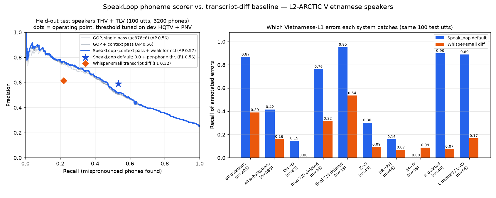

# Phone-level mispronunciation detection — L2-ARCTIC, Vietnamese L1

Does `speakloop.phoneme` find the phones a Vietnamese speaker actually got
wrong, and does it beat what an ordinary speech recogniser can tell a learner?



## Headline (held-out speakers THV + TLV)

Same 100 test utterances (3,200 annotated phones, 794 mispronounced) for every row,
because the Whisper baseline was transcribed for 50 utterances per test speaker:

| system | precision | recall | F1 |
|---|---|---|---|
| Whisper-small transcript diff (baseline) | 0.615 | 0.219 | 0.323 |
| GOP, single pass (as of ac378c6), dev-F1 threshold 2.5 | 0.436 | 0.635 | 0.517 |
| + context pass + weak forms, dev-F1 threshold 2.5 | 0.441 | 0.631 | 0.519 |
| + weak forms, product global threshold 0.0 | 0.575 | 0.479 | 0.522 |
| **SpeakLoop default: 0.0 + per-phone thresholds, false alarms ≤ 15 % on dev** | **0.589** | **0.533** | **0.560** |
| *(not shipped)* 0.0 + per-phone thresholds, no false-alarm cap | 0.606 | 0.681 | 0.641 |

Every SpeakLoop row on all 300 test utterances (10,067 phones, 2,558 mispronounced):

| system | precision | recall | F1 | AP |
|---|---|---|---|---|
| GOP, single pass (ac378c6), thr 2.5 | 0.463 | 0.706 | 0.560 | 0.625 |
| + context pass, thr 2.5 | 0.463 | 0.703 | 0.558 | 0.625 |
| + weak forms, thr 2.5 | 0.464 | 0.696 | 0.557 | 0.625 |
| + weak forms, thr 0.0 (product global default) | 0.600 | 0.534 | 0.565 | — |
| **SpeakLoop default (0.0 + per-phone, FA ≤ 15 %)** | **0.611** | **0.590** | **0.600** | — |
| high-precision point (dev precision ≥ 0.70, thr −4.25) | 0.780 | 0.313 | 0.446 | — |
| *(not shipped)* per-phone, no cap, around 2.5 | 0.494 | 0.778 | 0.604 | — |
| *(not shipped)* per-phone, no cap, around 0.0 | 0.605 | 0.705 | 0.651 | — |

**What the numbers say.** The phoneme scorer finds **2.4× as many real errors as
the transcript-diff baseline** (recall 0.53 vs 0.22 on the same utterances) at about the same precision
(0.59 vs 0.62). The baseline misses errors because Whisper's language model turns accented speech back
into the intended word: it caught **0 of 82** DH→D substitutions ("the" said as "de")
and 7 % of ER→AH and R deletions. The deletion recall gap is the widest: 0.87 vs 0.39.

## Per error category (same 100 test utterances)

Recall of the annotated error, plus precision/recall over every token of that
canonical phone (so false alarms on correct tokens count).

| category | n | SpeakLoop recall | baseline recall | SpeakLoop phone P / R | baseline phone P / R |
|---|---|---|---|---|---|
| all deletions | 205 | 0.87 | 0.39 | — | — |
| all substitutions | 589 | 0.42 | 0.16 | — | — |
| DH→D (`the`→`de`) | 82 | 0.15 | 0.00 | 0.94 / 0.17 | 1.00 / 0.02 |
| word-final T/D deleted | 38 | 0.76 | 0.32 | 0.76 / 0.71 | 0.83 / 0.38 |
| word-final Z/S deleted | 43 | 0.95 | 0.54 | 0.93 / 0.61 | 0.96 / 0.30 |
| Z→S | 43 | 0.30 | 0.09 | 0.95 / 0.63 | 1.00 / 0.30 |
| ER→AH | 44 | 0.16 | 0.07 | 0.79 / 0.23 | 1.00 / 0.08 |
| IH→IY | 46 | 0.00 | 0.09 | 0.67 / 0.11 | 0.50 / 0.16 |
| R deleted | 40 | 0.90 | 0.07 | 0.69 / 0.90 | 0.67 / 0.08 |
| L deleted / L→W | 54 | 0.89 | 0.17 | 0.84 / 0.89 | 0.82 / 0.17 |

False alarms on correctly pronounced phones: SpeakLoop default 12.3 % overall,
7.3 % on the function words to/the/a/an/of/and/for. Baseline: 4.5 % and 1.2 %.

**Diagnosis**, i.e. once an error is flagged, does SpeakLoop name the right fix?
(300 test utterances, default thresholds.) Flagged deletions were called deletions
89.9 % of the time (n = 664). For flagged substitutions, the phone SpeakLoop says
it heard matched the annotator's perceived phone 47.8 % of the time (n = 845).

## What changed in the scorer (this branch)

1. **Weak forms for function words** (`g2p.WEAK_FORMS`, `weak_form_variants`):
   to/the/a/an/of/and/for accept their reduced forms (/tə/, /ən/ with the d dropped, /fɚ/ …)
   at that position only. Per-word espeak gives the strong form ("to" → tuː,
   "and" → ænd), so before this change a native-like "tə" counted as an error.
   On test, false alarms on correct function-word phones went from **30.5 % to 22.0 %** at the same
   threshold, and F1 stayed flat (0.560 → 0.557). This change cuts false alarms; it
   does not add accuracy.
2. **Context pass** (`score_phones(context_pass=True)`): a second GOP pass where
   every other phone is set to its best *accepted* realisation, so two adjacent
   reductions ("to and" → "tə ən") don't make each other look wrong. Covered by
   a unit test. On L2-ARCTIC it is neutral (F1 0.560 → 0.558) because annotated
   canonical phones are already mostly reduced.
3. **Per-phone thresholds** (`assess.PHONE_THRESHOLDS`), tuned on dev only
   by coordinate ascent on dev F1 around the existing global default 0.0, **with the
   false-alarm rate on each phone's correct dev tokens capped at 15 %**:
   ð 2.75, d 2.5, z 2.75, l 3.0, ɜː/ɚ 1.75, ɹ 0.25, ʌ/ə 0.25, ɪ −5.5.
   Test F1 went from 0.565 to 0.600, with precision 0.600 → 0.611 and recall 0.534 → 0.590.
   They apply only when the caller passes no threshold and `SPEAKLOOP_GOP_THRESHOLD`
   is unset.

**Why the cap.** Without it, tuning learns to always flag ð and ɚ, because
Vietnamese speakers get them wrong 71 % / 62 % of the time. That scores best
(test F1 0.651), but on test it flagged **86 % of correctly said ð** and 97 % of
correct ɚ, which means telling a good speaker their "the" is wrong. That is a
base-rate prior, not acoustic evidence, so it is not shipped. With the cap, test
false alarms on correct tokens are ð 5.9 %, ɚ/ɜː 18.2 %, d 23.6 %, z 24.7 %,
ɹ 17.7 %, l 12.8 %.

## Method

* **Data**: L2-ARCTIC v5 manual annotations (TextGrid phone tier: correct /
  `CPL,PPL,s` substitution / `CPL,sil,d` deletion) for the 4 Vietnamese speakers.
  Ground truth for a phone: mispronounced if its label is a substitution or deletion.
  Additions have no canonical phone and are not scored.
* **Split**: dev = HQTV + PNV, first 30 annotated utterances each (60 utts, 1,966 phones;
  a subset because of compute). Test = THV + TLV, all 150 annotated utterances each
  (300 utts, 10,067 phones). Every threshold and per-phone value was picked on dev;
  test was never used for tuning.
* **SpeakLoop**: `facebook/wav2vec2-lv-60-espeak-cv-ft` (weights stored as bf16
  safetensors, computed in fp32, 2 threads). Its CTC log-posteriors are cached once per
  utterance (`cache_emissions.py`, 23.4 min of audio, acoustic RTF 0.47 on a shared
  2-vCPU ARM box). `score_phones` then runs on the corpus's **own canonical
  phones** (ARPAbet mapped to the model's IPA tokens), so the scorer is measured
  without G2P mismatch. The phone is flagged if GOP is below the threshold.
* **Baseline**: `openai/whisper-small` (fp32, CPU, English, greedy) transcribes each
  test utterance. The transcript is normalised (lower case, digits spelled out) and
  word-aligned to the reference by Levenshtein:
  - a dropped reference word flags all of its phones;
  - a replaced word flags the reference phones that don't align with the espeak-ng
    phones of the word Whisper heard (Levenshtein, native variants count as equal);
  - a word Whisper got right flags nothing.

  This simulates a "read the sentence, we compare the transcript" checker.
* **Metrics**: phone-level precision/recall/F1 for detection; AP = area under the
  test precision-recall curve as the GOP threshold sweeps.

## Limitations

* **4 speakers, one L1, read speech.** Results are for Vietnamese speakers reading
  ARCTIC prompts. Dev is only 60 utterances, so the per-phone thresholds are coarse
  (0.25 grid) and could shift with more dev data.
* **The baseline was run on 100 of the 300 test utterances** (50 per speaker) because
  Whisper-small on this shared CPU ran at about 4 utterances/min. The head-to-head table
  uses exactly those 100. SpeakLoop numbers on all 300 are a bit higher (F1 0.600 vs 0.560),
  so the subset is, if anything, harder for SpeakLoop.
* **DH→D and ER→AH remain weak (recall 0.15 / 0.16).** The espeak-CV fine-tuned
  model has a strong prior for the dictionary phone in very frequent words: for
  annotated "the"→"de", the median GOP still favours ð by 3.9 nats (correct ð: 5.1). There isn't enough
  acoustic separation to catch these without the false alarms described above.
  A phone recogniser trained on L2 speech (or fine-tuned on L2-ARCTIC train
  speakers) would be the fix.
* **IH→IY is effectively not reported** (ɪ threshold −5.5): on dev those flags
  were mostly false alarms.
* **Annotator canonical phones ≠ product G2P.** In the app the reference comes
  from espeak-ng per word, not from L2-ARCTIC's aligned canonical phones. Weak
  forms close part of that gap; other G2P differences are not measured here.
* **The baseline is one design**, a transcript diff with phone projection. A
  forced-alignment-confidence baseline would be stronger than a transcript diff.
* speechocean762 (utterance/word scores, Mandarin L1) was not run in this pass.

## Reproduce

```bash
# data: L2-ARCTIC HQTV/ PNV/ THV/ TLV/ folders (annotation/, wav/, transcript/)
export SPEAKLOOP_BENCH_DATA=/path/to/l2arctic SPEAKLOOP_BENCH_CACHE=$PWD/bench_cache
export SPEAKLOOP_PHONEME_MODEL=./models/lv60-bf16   # python -m speakloop.phoneme.convert facebook/wav2vec2-lv-60-espeak-cv-ft ./models/lv60-bf16
export SPEAKLOOP_PHONEME_DTYPE=float32 SPEAKLOOP_PHONEME_THREADS=2
sudo apt-get install -y espeak-ng

# 1. acoustic model once per utterance (resumable; ~2.3 GB RSS, run one model at a time)
python benchmarks/cache_emissions.py l2arctic --speakers THV,TLV
python benchmarks/cache_emissions.py l2arctic --speakers HQTV,PNV --per-speaker 30
# 2. baseline transcripts (resumable)
python benchmarks/asr_baseline.py transcribe --model openai/whisper-small --speakers THV,TLV --per-speaker 50
# 3. GOP for every annotated phone, baseline projection, report + chart
python benchmarks/eval_l2arctic.py score
python benchmarks/eval_l2arctic.py baseline
python benchmarks/eval_l2arctic.py report   # -> benchmarks/results_l2arctic.json, benchmarks/l2arctic_results.png
```

Machine for these numbers: 2 vCPU ARM Neoverse-V2, about 4 GB free RAM shared with other
jobs; torch 2.14.1+cpu, transformers 5.19.0, espeak-ng 1.52. The full numbers are
in `results_l2arctic.json`.
